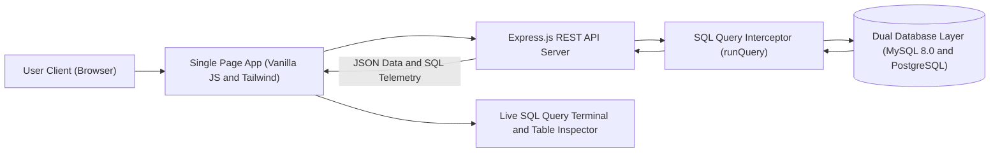

# ConnectSphere — Social Media Platform & Real-Time SQL Engine

> A full-stack social media web platform and interactive DBMS educational laboratory. Every single action taken on the website (creating posts, publishing comments, liking, following users, deleting posts) executes real SQL queries and displays the exact query, execution parameters, and database feedback live on the screen.

---

## 📚 Complete Technical Documentation

A comprehensive documentation suite is available in the **[`docs/`](file:///b:/Projects/ConnectSphere/ConnectSphere/docs/README.md)** directory:

- 📖 **[Documentation Master Index](file:///b:/Projects/ConnectSphere/ConnectSphere/docs/README.md)** — High-level project summary and directory guide.
- 🏗️ **[System Architecture](file:///b:/Projects/ConnectSphere/ConnectSphere/docs/system-architecture.md)** — Multi-tier architecture, dual-database engine, query interception, and sequence diagrams.
- 🗄️ **[Database Design & Schema](file:///b:/Projects/ConnectSphere/ConnectSphere/docs/database-design.md)** — Complete ER diagram (Mermaid), table DDL, Foreign Key cascades, CHECK constraints, and BCNF normalization proofs.
- 🔌 **[REST API Reference](file:///b:/Projects/ConnectSphere/ConnectSphere/docs/api-reference.md)** — Complete endpoint specs, request/response JSON schemas, and mapped SQL queries.
- 🔄 **[Features & System Workflows](file:///b:/Projects/ConnectSphere/ConnectSphere/docs/features-and-workflows.md)** — User authentication/perspective switcher, post creation pipeline, social graph, and query logger mechanics.
- ⚙️ **[Setup & Deployment Guide](file:///b:/Projects/ConnectSphere/ConnectSphere/docs/setup-and-deployment.md)** — Step-by-step local MySQL setup, Netlify serverless deployment, migrations, and troubleshooting FAQ.

---

## 🚀 Architectural Overview



---

## 🌟 Core Features

- **Social Media Core**:
  - Live timeline feed (**For You** / **Following** / **My Posts** filters).
  - Clean authentication system with role-based perspectives (**Regular Users** vs. **DBA Administrator**).
  - Rich post composer with file and image attachments (photos, PDFs, documents, code snippets).
  - Full interactive user profiles with relational counters (Posts, Followers, Following).
  - Interactive like and threaded comment drawers.
  - Light and Dark mode theme support with OS auto-detection.
  
- **DBMS Educational Engine**:
  - **Live SQL Query Logger**: Real-time terminal showing every `SELECT`, `INSERT`, `UPDATE`, `DELETE`, and `JOIN` query executed by the database engine.
  - **Live Database Table Explorer**: Browse all 5 relational tables (`Users`, `Posts`, `Comments`, `Likes`, `Followers`) with Primary Key (`PK`) and Foreign Key (`FK`) annotations.
  - **5 Executable Analytical Queries**:
    - **Q1**: Newsfeed generation with multi-table `JOIN`
    - **Q2**: Top liked posts via `LEFT JOIN` and `GROUP BY`
    - **Q3**: Most followed users via subquery aggregation
    - **Q4**: Threaded post comments join
    - **Q5**: User engagement metrics matrix
  - **ON DELETE CASCADE**: Deleting a post cascades automatically to all its likes and comments.
  - **CHECK Constraints**: Prevents self-follows (`follower_id <> following_id`).
  - **UNIQUE Constraints**: Enforced on usernames, emails, and like/follow pairs.

---

## 🏗️ Architecture & Technology Stack

- **Frontend**: Single Page Application (SPA) built with semantic HTML5, Tailwind CSS, Font Awesome, and vanilla JavaScript.
- **Backend**: Express.js REST API with serverless adapter support (`serverless-http`).
- **Database**:
  - **Netlify Database (PostgreSQL)**: Zero-config managed cloud database with automated migrations under `netlify/database/migrations/`.
  - **MySQL 8.0**: Connection pooling via `mysql2/promise` with DDL schema and seed scripts under `database/`.

---

## 📦 Project Structure

```
ConnectSphere/
├── database/                          # MySQL 8.0 schema & seed scripts
│   ├── schema.sql                     # Full relational DDL and seed data
│   └── seed.js                        # Node.js seed runner
├── db/                                # Netlify Database connection manager
│   └── index.js                       # PostgreSQL query adapter and parameter mapper
├── netlify/                           # Serverless deployment configuration
│   ├── database/migrations/           # Netlify Database automated migrations
│   │   ├── 20261113100000_create_connectsphere_schema.sql
│   │   └── 20261113100001_seed_initial_data.sql
│   └── functions/                     # Netlify Serverless Function wrapper
│       └── api.mjs                    # Netlify Functions v2 handler
├── public/                            # Frontend assets
│   ├── index.html                     # Semantic HTML5 UI, modals, layout
│   ├── app.js                         # Frontend logic, state, and query logging
│   ├── styles.css                     # Styles, themes, and animations
│   └── uploads/                       # Local uploaded assets
├── docs/                              # Detailed Technical Documentation
│   ├── README.md                      # Documentation index
│   ├── system-architecture.md         # Component and runtime architecture
│   ├── database-design.md             # ER diagrams, DDL, constraints, normalization
│   ├── api-reference.md               # Endpoints, schemas, and SQL mappings
│   ├── features-and-workflows.md      # User workflows, state diagrams, telemetry
│   └── setup-and-deployment.md        # Local and cloud deployment guide
├── netlify.toml                       # Netlify build & redirect routing
├── server.js                          # Express server & API endpoints
├── package.json                       # Project dependencies
└── README.md                          # Project overview
```

---

## 🛠️ Quick Start (Local Development)

### 1. Clone the repository
```bash
git clone https://github.com/Rio-Stuart/ConnectSphere.git
cd ConnectSphere
```

### 2. Install dependencies
```bash
npm install
```

### 3. Configure `.env` & Seed Database
```bash
cp .env.example .env
npm run seed
```

### 4. Run the development server
```bash
# Option A: Run standard Express server (default: port 3000)
npm start

# Option B: Run via Netlify CLI (mirrors cloud environment & database)
npx netlify dev
```

Visit **`http://localhost:3000`** in your browser.

---

## 📄 License

MIT License. Designed and developed for DBMS academic demonstration and social media platform architecture.
