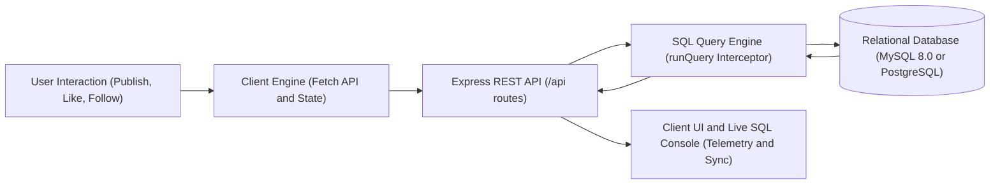

# ConnectSphere Documentation Suite

Welcome to the complete technical documentation for **ConnectSphere** — a dual-purpose web platform uniting a full-featured social media network with a live, interactive Database Management System (DBMS) execution and inspection laboratory.

---

## 📚 Documentation Index

| Document | Description | Key Topics |
| :--- | :--- | :--- |
| **[System Architecture](file:///b:/Projects/ConnectSphere/ConnectSphere/docs/system-architecture.md)** | Comprehensive high-level and component architecture | Multi-tier architecture, dual-database compatibility (MySQL & PostgreSQL), serverless bridge, Mermaid diagrams |
| **[Database Design & Schema](file:///b:/Projects/ConnectSphere/ConnectSphere/docs/database-design.md)** | Complete relational data modeling and constraints | ER diagram (Mermaid), table DDL, Foreign Keys & ON DELETE CASCADE, CHECK constraints, Normalization (1NF–BCNF), Indexing |
| **[REST API Reference](file:///b:/Projects/ConnectSphere/ConnectSphere/docs/api-reference.md)** | End-to-end API specification | Endpoints, query parameters, payloads, responses, bound SQL queries, and HTTP status codes |
| **[Features & System Workflows](file:///b:/Projects/ConnectSphere/ConnectSphere/docs/features-and-workflows.md)** | Detailed application flows and UI interaction models | Auth & role perspective switching, post lifecycle, media handling, real-time SQL logger, live table inspector, analytical queries |
| **[Setup & Deployment Guide](file:///b:/Projects/ConnectSphere/ConnectSphere/docs/setup-and-deployment.md)** | Developer onboarding and cloud deployment runbook | Local environment setup, MySQL configuration, Netlify Serverless & Netlify Database deployment, seeding, and troubleshooting |

---

## 🎯 Executive Overview

ConnectSphere was designed to solve a fundamental challenge in computer science education: the disconnection between abstract relational database theory (normalization, cascading foreign keys, query optimization, ACID compliance) and concrete software application engineering.

Rather than running isolated commands in a database terminal (`mysql>` or `psql`), ConnectSphere provides a sleek, modern social platform interface where **every user action executes real SQL statements and broadcasts the query, execution time, and bound parameters live to a real-time terminal on the user interface.**



---

## 🌟 Key Capabilities

1. **Social Networking Core**:
   - Timeline feed filtering: **For You (All)**, **Following**, and **My Posts**.
   - User authentication and role-based perspectives (**Regular User** vs. **DBA Administrator**).
   - Rich media post creation: text, hashtags, photos, PDF/document attachments, and code snippets.
   - User profile cards with dynamic relational counters (Posts, Followers, Following).
   - Interactive liking and threaded comment drawers.
   - Directed social graph (Follow/Unfollow system with self-follow prevention).

2. **DBMS Educational & Inspection Engine**:
   - **Real-Time SQL Query Logger**: Live terminal tracking every `SELECT`, `INSERT`, `UPDATE`, `DELETE`, and `JOIN` query executed by the database.
   - **Live Relational Table Explorer**: Live interactive browser across all 5 tables (`Users`, `Posts`, `Comments`, `Likes`, `Followers`) with Primary Key (`PK`) and Foreign Key (`FK`) annotations.
   - **5 Analytical Benchmark Queries**:
     - *Q1: Newsfeed Generation* (Multi-table `INNER JOIN` + Subqueries)
     - *Q2: Top Liked Posts* (`LEFT JOIN` + `GROUP BY` + Aggregation)
     - *Q3: Follower Leaderboard* (Subquery Aggregation)
     - *Q4: Threaded Post Comments* (3-Way `JOIN`)
     - *Q5: User Engagement Analytics View* (Cross-table multi-metric aggregation)
   - **Relational Integrity Guarantees**:
     - `ON DELETE CASCADE` on all dependent tables.
     - `CHECK (follower_id <> following_id)` to forbid self-follows.
     - `UNIQUE` constraints preventing duplicate likes, duplicate follow links, or colliding usernames/emails.
   - **Dual Database Engine**:
     - Local Development: **MySQL 8.0** with InnoDB connection pooling (`mysql2/promise`).
     - Cloud Serverless: **Netlify Database (PostgreSQL)** via `@netlify/database` and `pg.Pool`.

---

## 📂 Project Repository Structure

```
ConnectSphere/
├── database/                          # MySQL 8.0 Database Schemas & Seeding
│   ├── schema.sql                     # Full DDL & initial DML seed statements
│   └── seed.js                        # Node.js automated database seed runner
├── db/                                # Cloud Database Connection Manager
│   └── index.js                       # Netlify Database (PostgreSQL) adapter & query converter
├── netlify/                           # Serverless Cloud Configuration
│   ├── database/migrations/           # Netlify DB versioned migrations
│   │   ├── 20261113100000_create_connectsphere_schema.sql
│   │   └── 20261113100001_seed_initial_data.sql
│   └── functions/                     # Serverless API lambda wrapper
│       └── api.mjs                    # Netlify Functions v2 handler (serverless-http)
├── public/                            # Client-Side Frontend Assets
│   ├── index.html                     # Semantic HTML5 UI, modals, layouts
│   ├── app.js                         # State management, query logging, API calls
│   ├── styles.css                     # Custom styling, dark/light theme, animations
│   └── uploads/                       # Local uploaded images & media attachments
├── docs/                              # Project Documentation Suite
│   ├── README.md                      # Documentation index & executive overview
│   ├── system-architecture.md         # Component, multi-tier & serverless architecture
│   ├── database-design.md             # ER diagrams, schema DDL, constraints, normalization
│   ├── api-reference.md               # Complete REST API specifications & SQL mappings
│   ├── features-and-workflows.md      # User workflows, state transitions, query logging
│   └── setup-and-deployment.md        # Local setup, Netlify cloud guide, and FAQ
├── server.js                          # Express.js REST API & SQL query engine
├── package.json                       # Dependencies & npm scripts
├── netlify.toml                       # Netlify build & redirect routing config
└── .env.example                       # Environment configuration template
```

---

## 🚀 Getting Started

To explore the architecture and codebase in depth:
1. Start with **[System Architecture](file:///b:/Projects/ConnectSphere/ConnectSphere/docs/system-architecture.md)** to understand how client, server, and databases interconnect.
2. Review **[Database Design & Schema](file:///b:/Projects/ConnectSphere/ConnectSphere/docs/database-design.md)** for data models, normalization, and constraints.
3. Consult **[Setup & Deployment Guide](file:///b:/Projects/ConnectSphere/ConnectSphere/docs/setup-and-deployment.md)** to spin up the local development server or deploy to Netlify.
