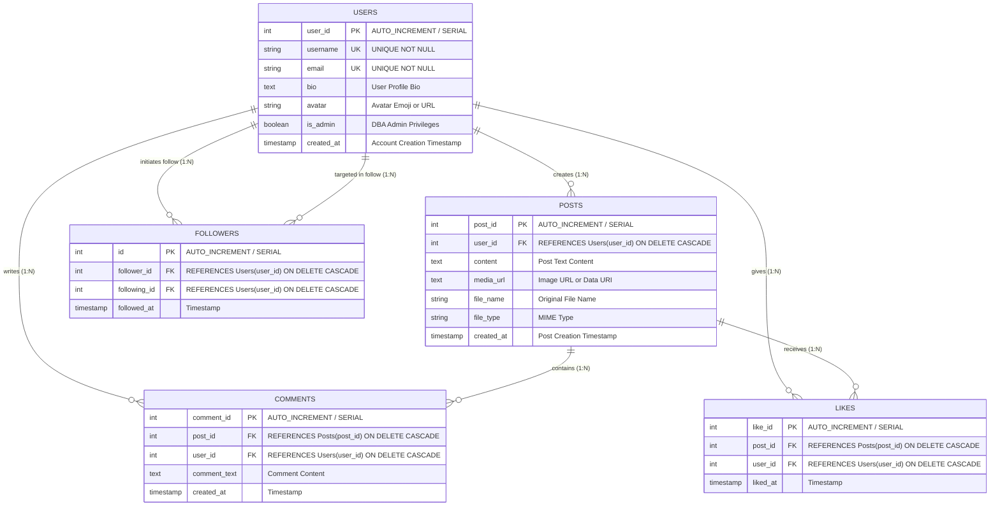
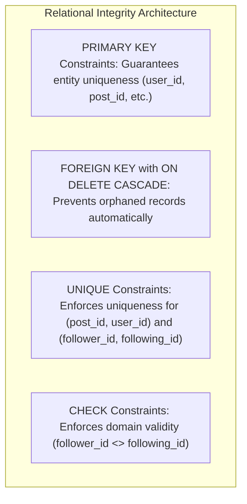

# Relational Database Design & Schema Specification

This document provides the definitive data model reference, Entity-Relationship (ER) design, normalization proofs, constraints, and indexing strategy for **ConnectSphere**.

---

## 1. Entity-Relationship (ER) Model

The database is built on 5 fundamental relations: **Users**, **Posts**, **Comments**, **Likes**, and **Followers**.



---

## 2. Table Specifications & DDL

### 2.1 Table: `Users`
Stores authentication identities, credentials, bio descriptions, and role privileges.

| Column | Data Type | Modifiers | Description |
| :--- | :--- | :--- | :--- |
| `user_id` | `INT` / `SERIAL` | `PRIMARY KEY`, Auto Increment | Unique synthetic identifier |
| `username` | `VARCHAR(50)` | `NOT NULL`, `UNIQUE` | Unique user handle (e.g. `aarav_tech`) |
| `email` | `VARCHAR(100)` | `NOT NULL`, `UNIQUE` | User electronic mail address |
| `bio` | `TEXT` | `NULL` allowed | User self-description and profile summary |
| `avatar` | `VARCHAR(255)` | `DEFAULT '👤'` | User display avatar (emoji or image path) |
| `is_admin` | `BOOLEAN` | `DEFAULT FALSE` | Role flag granting DBA console features |
| `created_at` | `TIMESTAMP` | `DEFAULT CURRENT_TIMESTAMP` | Account registration timestamp |

```sql
CREATE TABLE Users (
    user_id    INT          PRIMARY KEY AUTO_INCREMENT,
    username   VARCHAR(50)  UNIQUE NOT NULL,
    email      VARCHAR(100) UNIQUE NOT NULL,
    bio        TEXT,
    avatar     VARCHAR(255) DEFAULT '👤',
    is_admin   BOOLEAN      DEFAULT FALSE,
    created_at TIMESTAMP    DEFAULT CURRENT_TIMESTAMP
) ENGINE=InnoDB DEFAULT CHARSET=utf8mb4 COLLATE=utf8mb4_unicode_ci;
```

---

### 2.2 Table: `Posts`
Captures micro-blog articles, media attachments (images, PDFs, documents), and author authorship links.

| Column | Data Type | Modifiers | Description |
| :--- | :--- | :--- | :--- |
| `post_id` | `INT` / `SERIAL` | `PRIMARY KEY`, Auto Increment | Unique post identifier |
| `user_id` | `INT` | `NOT NULL`, `FOREIGN KEY` | Author's primary key in `Users` |
| `content` | `TEXT` | `NOT NULL` | Post body message (supports hashtags) |
| `media_url` | `TEXT` | `DEFAULT NULL` | Web path or base64 Data URI |
| `file_name` | `VARCHAR(255)` | `DEFAULT NULL` | Original filename of attached asset |
| `file_type` | `VARCHAR(100)` | `DEFAULT NULL` | MIME type (e.g. `image/jpeg`, `application/pdf`) |
| `created_at` | `TIMESTAMP` | `DEFAULT CURRENT_TIMESTAMP` | Post creation timestamp |

```sql
CREATE TABLE Posts (
    post_id    INT          PRIMARY KEY AUTO_INCREMENT,
    user_id    INT          NOT NULL,
    content    TEXT         NOT NULL,
    media_url  TEXT         DEFAULT NULL,
    file_name  VARCHAR(255) DEFAULT NULL,
    file_type  VARCHAR(100) DEFAULT NULL,
    created_at TIMESTAMP    DEFAULT CURRENT_TIMESTAMP,
    INDEX idx_posts_user (user_id),
    CONSTRAINT fk_posts_user FOREIGN KEY (user_id) REFERENCES Users(user_id) ON DELETE CASCADE
) ENGINE=InnoDB DEFAULT CHARSET=utf8mb4 COLLATE=utf8mb4_unicode_ci;
```

---

### 2.3 Table: `Comments`
Maintains threaded discussions beneath published posts.

| Column | Data Type | Modifiers | Description |
| :--- | :--- | :--- | :--- |
| `comment_id`| `INT` / `SERIAL` | `PRIMARY KEY`, Auto Increment | Unique comment identifier |
| `post_id` | `INT` | `NOT NULL`, `FOREIGN KEY` | Parent post ID |
| `user_id` | `INT` | `NOT NULL`, `FOREIGN KEY` | Comment author ID |
| `comment_text`| `TEXT` | `NOT NULL` | Text body of the comment |
| `created_at`| `TIMESTAMP` | `DEFAULT CURRENT_TIMESTAMP` | Comment submission timestamp |

```sql
CREATE TABLE Comments (
    comment_id   INT       PRIMARY KEY AUTO_INCREMENT,
    post_id      INT       NOT NULL,
    user_id      INT       NOT NULL,
    comment_text TEXT      NOT NULL,
    created_at   TIMESTAMP DEFAULT CURRENT_TIMESTAMP,
    INDEX idx_comments_post (post_id),
    INDEX idx_comments_user (user_id),
    CONSTRAINT fk_comments_post FOREIGN KEY (post_id) REFERENCES Posts(post_id) ON DELETE CASCADE,
    CONSTRAINT fk_comments_user FOREIGN KEY (user_id) REFERENCES Users(user_id) ON DELETE CASCADE
) ENGINE=InnoDB DEFAULT CHARSET=utf8mb4 COLLATE=utf8mb4_unicode_ci;
```

---

### 2.4 Table: `Likes`
Captures social endorsements for posts, enforcing atomic uniqueness per user/post pair.

| Column | Data Type | Modifiers | Description |
| :--- | :--- | :--- | :--- |
| `like_id` | `INT` / `SERIAL` | `PRIMARY KEY`, Auto Increment | Unique like transaction ID |
| `post_id` | `INT` | `NOT NULL`, `FOREIGN KEY` | Target post ID |
| `user_id` | `INT` | `NOT NULL`, `FOREIGN KEY` | User endorsing the post |
| `liked_at`| `TIMESTAMP` | `DEFAULT CURRENT_TIMESTAMP` | Endorsement timestamp |

```sql
CREATE TABLE Likes (
    like_id  INT       PRIMARY KEY AUTO_INCREMENT,
    post_id  INT       NOT NULL,
    user_id  INT       NOT NULL,
    liked_at TIMESTAMP DEFAULT CURRENT_TIMESTAMP,
    UNIQUE KEY uq_likes_post_user (post_id, user_id),
    INDEX idx_likes_post (post_id),
    INDEX idx_likes_user (user_id),
    CONSTRAINT fk_likes_post FOREIGN KEY (post_id) REFERENCES Posts(post_id) ON DELETE CASCADE,
    CONSTRAINT fk_likes_user FOREIGN KEY (user_id) REFERENCES Users(user_id) ON DELETE CASCADE
) ENGINE=InnoDB DEFAULT CHARSET=utf8mb4 COLLATE=utf8mb4_unicode_ci;
```

---

### 2.5 Table: `Followers`
Models the directed social graph connecting platform participants.

| Column | Data Type | Modifiers | Description |
| :--- | :--- | :--- | :--- |
| `id` | `INT` / `SERIAL` | `PRIMARY KEY`, Auto Increment | Follow link record ID |
| `follower_id` | `INT` | `NOT NULL`, `FOREIGN KEY` | User initiating the follow |
| `following_id`| `INT` | `NOT NULL`, `FOREIGN KEY` | User being followed |
| `followed_at` | `TIMESTAMP` | `DEFAULT CURRENT_TIMESTAMP` | Follow relationship creation timestamp |

```sql
CREATE TABLE Followers (
    id           INT       PRIMARY KEY AUTO_INCREMENT,
    follower_id  INT       NOT NULL,
    following_id INT       NOT NULL,
    followed_at  TIMESTAMP DEFAULT CURRENT_TIMESTAMP,
    UNIQUE KEY uq_follower_pair (follower_id, following_id),
    CONSTRAINT chk_no_self_follow CHECK (follower_id <> following_id),
    INDEX idx_followers_follower (follower_id),
    INDEX idx_followers_following (following_id),
    CONSTRAINT fk_followers_follower  FOREIGN KEY (follower_id)  REFERENCES Users(user_id) ON DELETE CASCADE,
    CONSTRAINT fk_followers_following FOREIGN KEY (following_id) REFERENCES Users(user_id) ON DELETE CASCADE
) ENGINE=InnoDB DEFAULT CHARSET=utf8mb4 COLLATE=utf8mb4_unicode_ci;
```

---

## 3. Relational Constraints & Integrity Rules



### 3.1 Referential Integrity Cascades (`ON DELETE CASCADE`)
All foreign keys in ConnectSphere enforce `ON DELETE CASCADE`:
1. **User Deletion**:
   - Deleting a row from `Users` cascades into:
     - All `Posts` created by that user.
     - All `Comments` written by that user.
     - All `Likes` given by that user.
     - All rows in `Followers` where the user is either the follower or the following party.
2. **Post Deletion**:
   - Deleting a row from `Posts` automatically cascades into:
     - All `Comments` belonging to that post.
     - All `Likes` given to that post.
   - Eliminates the need for manual cleanup scripts or multi-step manual deletions.

### 3.2 Candidate Key Uniqueness
- `Users.username` and `Users.email` are marked `UNIQUE`, preventing duplicate identity registrations.
- `Likes(post_id, user_id)` is a composite `UNIQUE` key. Any attempt to like a post more than once results in a constraint violation error (`ER_DUP_ENTRY` / PostgreSQL `23505`), safeguarding idempotent like-toggling logic.
- `Followers(follower_id, following_id)` is a composite `UNIQUE` key, preventing duplicate edges in the social graph.

### 3.3 Domain Constraint (`CHECK`)
To prevent users from following their own profile, a domain-level check constraint is enforced directly in the database engine:
```sql
CONSTRAINT chk_no_self_follow CHECK (follower_id <> following_id)
```
Even if an API client bypasses frontend validation, the database rejects the invalid tuple with an explicit error.

---

## 4. Normalization Analysis

ConnectSphere's relational schema satisfies **Boyce-Codd Normal Form (BCNF)**:


### 4.1 First Normal Form (1NF)
- **Criterion**: Every column contains only atomic (indivisible) values. No repeating groups or multivalued arrays exist.
- **Proof**: Attributes such as `bio`, `created_at`, `comment_text`, and `media_url` store single scalar values. All rows are uniquely identifiable through synthetic integer primary keys.

### 4.2 Second Normal Form (2NF)
- **Criterion**: Must be in 1NF, and all non-prime attributes must be fully functionally dependent on the entire candidate key (no partial dependencies on composite keys).
- **Proof**: 
  - In `Users`, `Posts`, and `Comments`, each relation uses a single-attribute primary key (`user_id`, `post_id`, `comment_id`), rendering partial key dependencies mathematically impossible.
  - In `Likes` and `Followers`, the candidate keys are composite `(post_id, user_id)` and `(follower_id, following_id)`. The only non-key attributes are timestamps (`liked_at`, `followed_at`), which depend strictly on the complete interaction pair, not on a single user or post.

### 4.3 Third Normal Form (3NF)
- **Criterion**: Must be in 2NF, and no non-prime attribute may transitively depend on a candidate key ($X \to Y \to Z$).
- **Proof**:
  - In `Posts`, author details (e.g. `username`, `email`, `avatar`) are intentionally **not** stored; only `user_id` is maintained. To display username with a post, the application performs an `INNER JOIN Users`.
  - In `Comments`, post titles or user emails are omitted; references rely strictly on `post_id` and `user_id`.
  - Thus, zero transitive functional dependencies exist.

### 4.4 Boyce-Codd Normal Form (BCNF)
- **Criterion**: For every non-trivial functional dependency $X \to Y$, $X$ must be a superkey.
- **Proof**:
  - `Users`: Functional dependencies are `user_id -> {username, email, bio, avatar, is_admin, created_at}`, `username -> user_id`, and `email -> user_id`. In every case, the left-hand side is a superkey (candidate key).
  - `Posts`, `Comments`, `Likes`, `Followers`: All determinants are superkeys.
  - Therefore, the schema is certified in BCNF.

---

## 5. Indexing Architecture & Performance

To optimize high-frequency read queries and multi-table joins, secondary B-Tree indexes are applied on foreign keys and search paths:

| Table | Index Name | Indexed Columns | Justification & Query Optimization |
| :--- | :--- | :--- | :--- |
| `Posts` | `idx_posts_user` | `(user_id)` | Accelerates profile lookups (`WHERE user_id = ?`) and `JOIN Posts ON Users.user_id = Posts.user_id` |
| `Comments` | `idx_comments_post` | `(post_id)` | Speeds up fetching threaded comments under a post (`WHERE post_id = ? ORDER BY created_at ASC`) |
| `Comments` | `idx_comments_user` | `(user_id)` | Optimizes user activity reporting and engagement metrics |
| `Likes` | `idx_likes_post` | `(post_id)` | Optimizes like counter subqueries: `(SELECT COUNT(*) FROM Likes WHERE post_id = p.post_id)` |
| `Likes` | `idx_likes_user` | `(user_id)` | Accelerates user like state verification (`WHERE post_id = ? AND user_id = ?`) |
| `Followers` | `idx_followers_follower` | `(follower_id)` | Speeds up "Following" feed filter subquery (`WHERE user_id IN (SELECT following_id FROM Followers WHERE follower_id = ?)`) |
| `Followers` | `idx_followers_following`| `(following_id)` | Speeds up follower counter aggregation and leaderboard queries |
