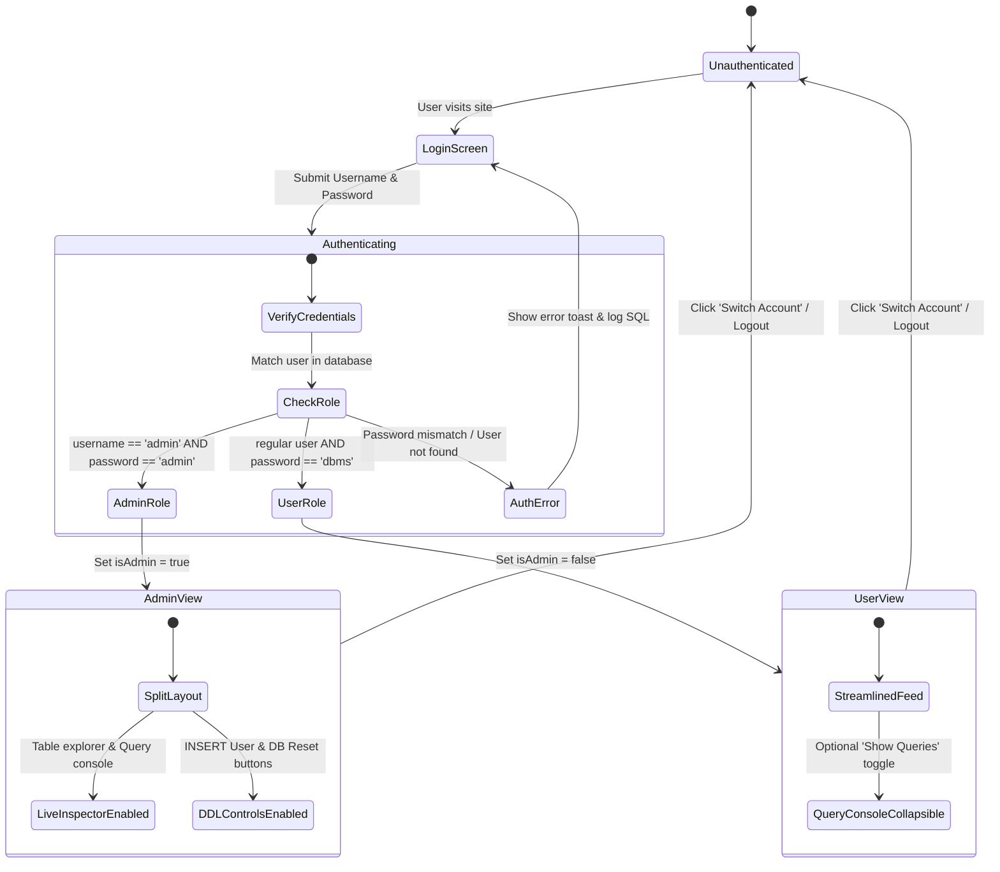
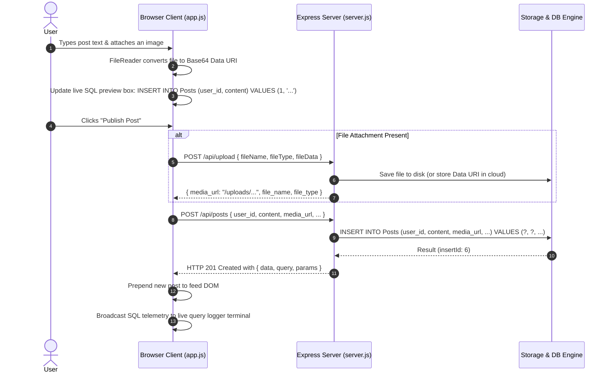
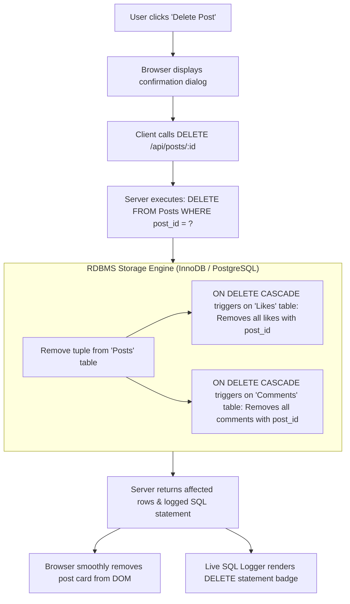
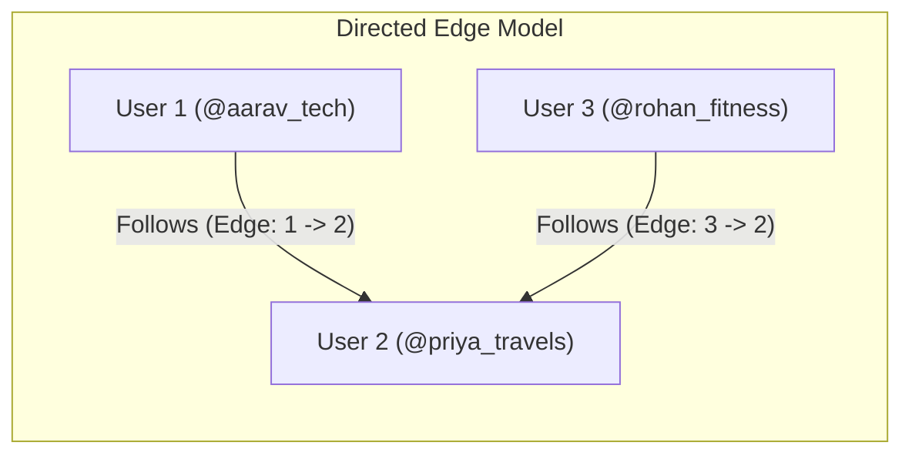
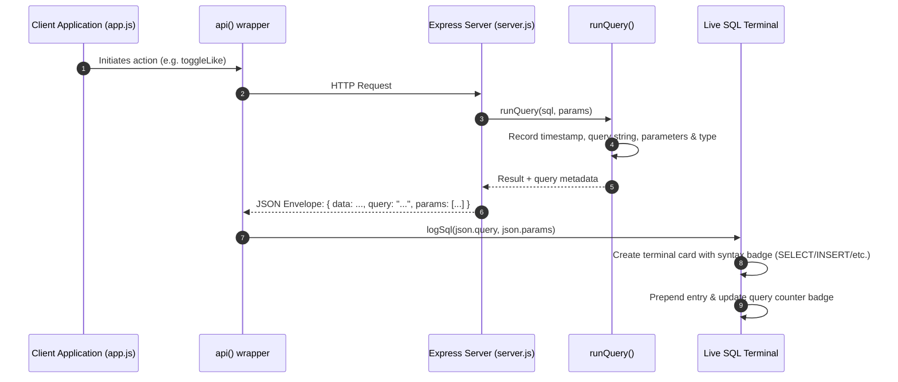
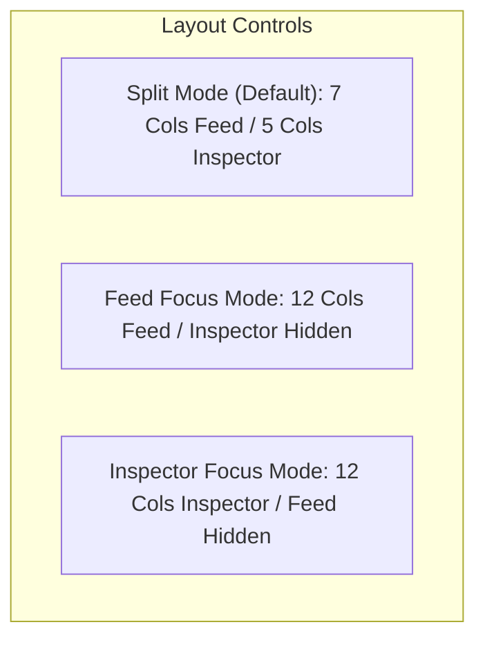

# Features & System Workflows

This document describes the key end-to-end user workflows, behavioral mechanics, and architectural interactions implemented in **ConnectSphere**.

---

## 1. Authentication & Perspective Switcher Workflow

ConnectSphere features a role-aware authentication system that dynamically shifts the interface between a streamlined **Social Media Consumer Perspective** and a high-powered **Database Administrator (DBA) Perspective**.



### 1.1 Credential Verification Rules
- **Administrator Account (`admin`)**:
  - Requires password: `admin`.
  - Exposes administrative controls: **INSERT User Modal**, **Layout Switcher** (Split, Feed Focus, Inspector Focus), and **Database Reset** button.
- **Demo User Accounts (`aarav_tech`, `priya_travels`, `rohan_fitness`, `neha_art`)**:
  - Require password: `dbms`.
  - Presents a clean social feed experience with an optional **Show Queries** toggle button.
- **Account Quick Selectors**:
  - The login screen includes interactive pills populated from the live `Users` table, allowing users to switch perspectives easily.

---

## 2. Post Creation & Media Attachment Workflow

Publishing a post handles text content, hashtags, and optional file attachments (photos, PDFs, documents, code snippets).



### 2.1 Live SQL Composer Preview
As the user types into the post composer textarea, the frontend runs real-time string interpolation to preview the exact parameterized SQL statement that will be dispatched to the server:
```sql
INSERT INTO Posts (user_id, content, media_url, file_name, file_type) 
VALUES (1, 'What is happening in DBMS?', NULL, NULL, NULL);
```

---

## 3. Post Deletion & Cascading Elimination Workflow

When a post is deleted, referential integrity cascades take effect inside the RDBMS storage engine without requiring complex server-side manual delete chains:



---

## 4. Directed Social Graph & Feed Filtering Workflow

ConnectSphere models follower networks as a directed graph using the `Followers` table:



### 4.1 Self-Follow Prevention
When a follow action is initiated:
1. **Frontend Guard**: The UI disables the follow button on one's own profile card and hides self-follow actions.
2. **API Layer Check**: `server.js` verifies `if (Number(follower_id) === Number(following_id))` and returns `400 Bad Request`.
3. **Database Engine Constraint**: The table definition includes `CONSTRAINT chk_no_self_follow CHECK (follower_id <> following_id)`. Even if an arbitrary request hits the database, the engine rejects the invalid tuple.

### 4.2 Feed Filtering Modes
The feed can be switched dynamically between three distinct views:

| Filter Mode | Client Filter | Underlying SQL `WHERE` Strategy |
| :--- | :--- | :--- |
| **For You (All)** | `filter=all` | No `WHERE` filter on author; returns all posts sorted by `created_at DESC`. |
| **Following** | `filter=following` | `WHERE p.user_id IN (SELECT following_id FROM Followers WHERE follower_id = ?)` |
| **My Posts** | `filter=my` | `WHERE p.user_id = ?` (Only posts written by the logged-in user). |

---

## 5. Real-Time SQL Query Telemetry Engine

One of the defining aspects of ConnectSphere is its real-time query interception and telemetry display.



### 5.1 Query Type Detection & Color Badges
The frontend analyzes the query prefix to assign semantic color tags:
- **`SELECT`**: Blue badge (`badge-select`)
- **`INSERT`**: Emerald badge (`badge-insert`)
- **`UPDATE`**: Amber badge (`badge-update`)
- **`DELETE`**: Rose badge (`badge-delete`)
- **`DDL` (CREATE/DROP/ALTER)**: Purple badge

---

## 6. Live Relational Table Inspector & Sync

The database inspector on the right pane allows users to browse raw table data live:
- **Tabs**: `Users`, `Posts`, `Comments`, `Likes`, `Followers`.
- **Live Sync**: Whenever an action occurs (like, comment, post), the client updates the active table tab to reflect the latest state.
- **Key Badges**:
  - Primary Key columns are marked with `<span class="badge-pk">PK</span>`.
  - Foreign Key references are annotated with `<span class="badge-fk">FK</span>`.
- **Data Rendering**:
  - Cell truncation for long text content.
  - Formatted timestamps for readability.

---

## 7. UI Layout Modes & Responsive Design

ConnectSphere features a 3-way layout engine tailored for both social engagement and database demonstration:



- **Split View (`split`)**: Balanced dual-pane view showing the live social network on the left and the DBMS inspector / query console on the right.
- **Feed Focus (`feed`)**: Expands the social timeline to full width, ideal for standard user browsing.
- **Inspector Focus (`inspector`)**: Expands the live SQL logger and table viewer across the entire screen, ideal for technical presentations, query reviews, and DBMS lab benchmarks.
