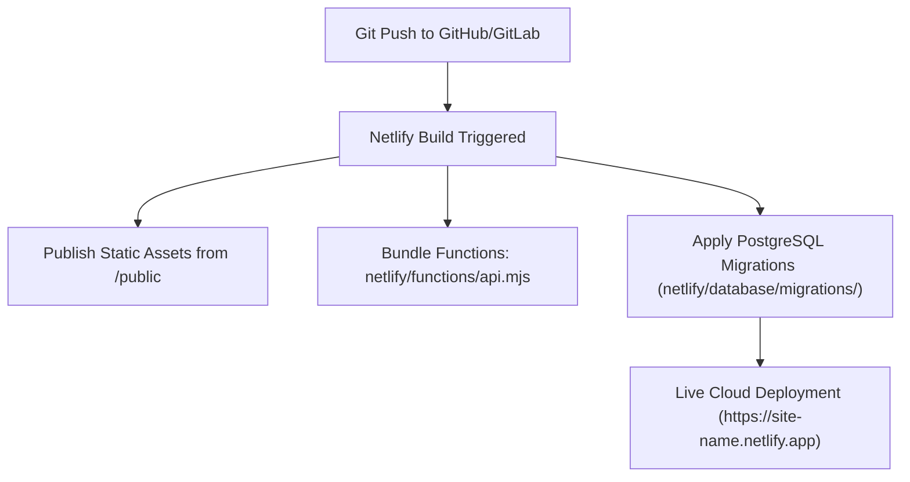

# Setup, Installation & Deployment Guide

This guide covers setting up ConnectSphere locally with MySQL and deploying it to the cloud using Netlify Functions and Netlify Database (PostgreSQL).

---

## 1. Prerequisites

Before installing ConnectSphere, ensure you have the following installed:
- **Node.js**: v18.0.0 or higher ([Download Node.js](https://nodejs.org/))
- **npm**: v9.0.0 or higher (packaged with Node.js)
- **Git**: ([Download Git](https://git-scm.com/))
- **Database Engine** (choose one):
  - **Local Development**: MySQL 8.0+ Community Server or MariaDB 10.5+
  - **Cloud Serverless**: Netlify Database (PostgreSQL) or any external PostgreSQL URL

---

## 2. Local Environment Setup (Node.js + MySQL)

### Step 2.1: Clone the Repository
```bash
git clone https://github.com/Rio-Stuart/ConnectSphere.git
cd ConnectSphere
```

### Step 2.2: Install Node.js Dependencies
```bash
npm install
```
Key production dependencies installed:
- `express`: Core REST API framework
- `mysql2`: Fast MySQL driver supporting connection pools and prepared statements
- `pg` & `@netlify/database`: PostgreSQL client for cloud database compatibility
- `cors`: Cross-origin request enablement
- `dotenv`: Environment configuration parser
- `serverless-http`: Lambda adapter for serverless deployment

---

### Step 2.3: Configure Environment Variables
Copy `.env.example` to create your local `.env` file:
```bash
cp .env.example .env
```
Edit `.env` to match your local MySQL installation:
```ini
# MySQL Database Configuration
DB_HOST=localhost
DB_PORT=3306
DB_USER=root
DB_PASSWORD=your_mysql_password
DB_NAME=connectsphere

# Express Web Server Port
PORT=3000

# Optional: Enable SSL for remote MySQL instances
# DB_SSL=true
```

---

### Step 2.4: Initialize & Seed the Database
You can initialize the database using either of the following methods:

**Method A: Dedicated Seed Script (Recommended)**
```bash
npm run seed
```
This script executes `database/schema.sql`, creates the `connectsphere` database, creates all 5 tables with foreign keys and check constraints, and inserts initial seed data.

**Method B: Automatic Server Schema Verification**
When `server.js` boots, it tests connectivity to MySQL. If the `connectsphere` database does not exist, it automatically reads `database/schema.sql` and initializes the entire schema and seed data.

---

### Step 2.5: Launch the Development Server
```bash
npm start
```
You will see output confirming the database connection:
```
✅ Connected to MySQL database "connectsphere" at localhost:3306
🚀 ConnectSphere server running on MySQL at http://localhost:3000
```
Open **`http://localhost:3000`** in your web browser.

---

## 3. Cloud Deployment (Netlify Serverless & PostgreSQL)

ConnectSphere includes built-in configurations for continuous deployment on **Netlify** with zero server maintenance.



### Step 3.1: Netlify Build Configuration (`netlify.toml`)
The repository is pre-configured with `netlify.toml`:
```toml
[build]
  publish = "public"
  functions = "netlify/functions"

[[redirects]]
  from = "/*"
  to = "/index.html"
  status = 200
```

### Step 3.2: Automated Migrations
Netlify Database automatically discovers and runs migration files in timestamp order from `netlify/database/migrations/`:
- `20261113100000_create_connectsphere_schema.sql`: Creates `users`, `posts`, `comments`, `likes`, `followers` in PostgreSQL with sequences and cascades.
- `20261113100001_seed_initial_data.sql`: Populates sample users, posts with image links, comments, and follower edges.

### Step 3.3: Deploying via Netlify CLI
1. Install Netlify CLI globally:
   ```bash
   npm install -g netlify-cli
   ```
2. Authenticate and link your site:
   ```bash
   netlify login
   netlify init
   ```
3. Test locally in the Netlify cloud-mirror environment:
   ```bash
   netlify dev
   ```
4. Deploy to production:
   ```bash
   netlify deploy --prod
   ```

---

## 4. Database Reset Procedures

ConnectSphere supports quick database resets to return to a clean demo state:

### Option 1: Via the Web Interface
1. Sign in with the **`admin`** account (Password: `admin`).
2. Click the **Reset DB State** button in the top navigation bar (red reload icon).
3. Confirm the modal dialog. The server will re-run the full schema and seed files.

### Option 2: Via Command Line
```bash
npm run seed
```

---

## 5. Troubleshooting & FAQ

### 1. `ER_ACCESS_DENIED_ERROR` (MySQL Authentication Failure)
- **Cause**: The password or username in `.env` does not match your MySQL server credentials.
- **Resolution**:
  - Open MySQL command line: `mysql -u root -p`.
  - Verify your password.
  - Update `DB_PASSWORD` in `.env` to match.

### 2. `ECONNREFUSED 127.0.0.1:3306` (MySQL Not Running)
- **Cause**: The MySQL service is stopped.
- **Resolution**:
  - **Windows**: Start via Services app or run `net start MySQL80` in an administrative terminal.
  - **macOS**: Run `brew services start mysql`.
  - **Linux**: Run `sudo systemctl start mysql`.

### 3. `EADDRINUSE: address already in use :::3000`
- **Cause**: Another service or a previous instance of ConnectSphere is using port 3000.
- **Resolution**:
  - Change the port in `.env` (e.g. `PORT=3001`).
  - Or terminate the conflicting process:
    - **Windows**: `Get-Process -Id (Get-NetTCPConnection -LocalPort 3000).OwningProcess | Stop-Process`
    - **Unix**: `npx kill-port 3000`

### 4. Large Image Upload Fails
- **Cause**: File exceeds the Express request limit or serverless payload ceiling.
- **Resolution**:
  - Express is configured with `limit: '25mb'` in `server.js`.
  - If deploying to serverless platforms with hard request ceilings (e.g., AWS Lambda 6MB limit), keep file attachments under 5MB for optimal reliability.
