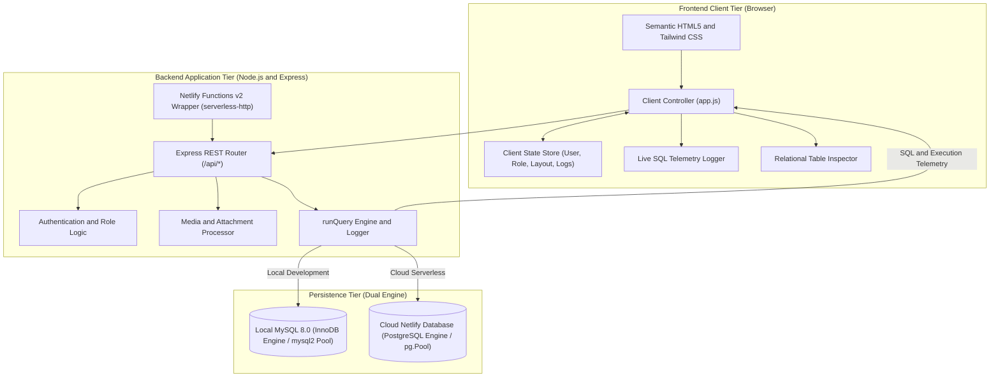
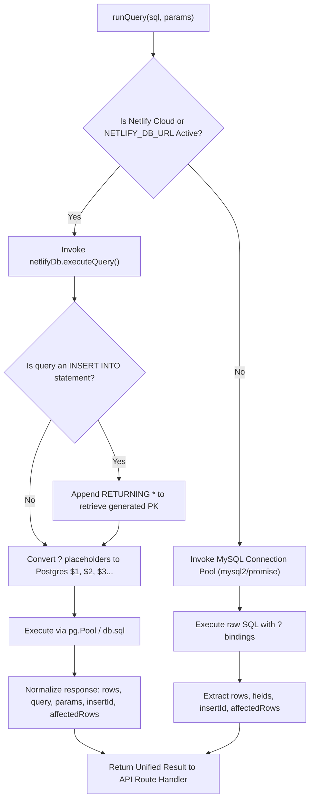
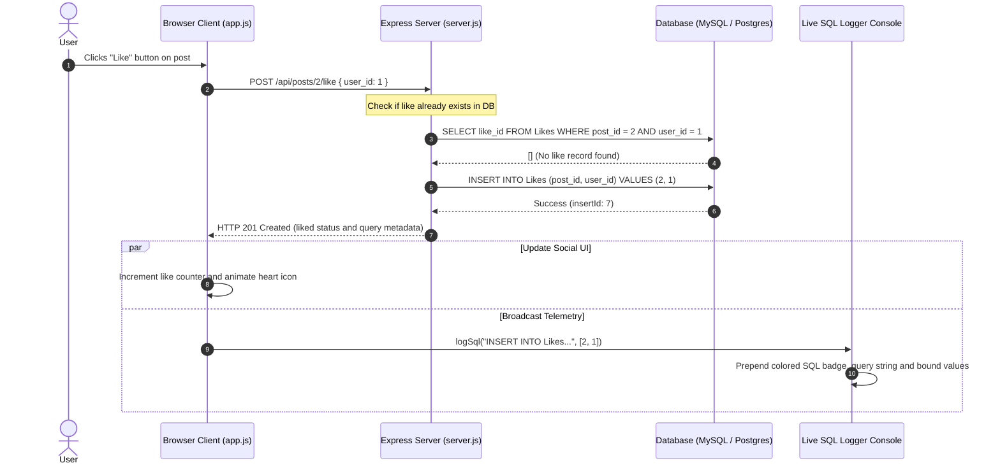

# System Architecture & Technical Design

This document details the software architecture, runtime topology, data flow, and design patterns powering **ConnectSphere**.

---

## 1. High-Level Architectural Model

ConnectSphere is structured as a decoupled multi-tier architecture with an intelligent, dual-dialect database abstraction layer:



---

## 2. Architectural Layers

### 2.1 Presentation & Client Tier
The user interface is engineered as a zero-dependency, high-performance Single Page Application (SPA):
- **Semantic HTML5 & Native Elements**: Implements modern accessibility and web standards using `<dialog>` for modal viewports, `<header>`, `<main>`, `<section>`, and `<form>`.
- **Tailwind CSS Utility Engine**: Fast styling with a responsive grid layout supporting dynamic column switching.
- **Font Awesome 6.4**: Universal iconography for database operations, media formats, and navigation.
- **Custom Theme System**: Automatic detection of OS color schemes (`prefers-color-scheme`) with dynamic user toggle between Dark (`#0b0f19`) and Light (`#f8fafc`) modes, persisted in `localStorage`.
- **Client State Management (`public/app.js`)**:
  - Maintains `activeUserId`, `activeUser` profile object, `isAdmin` DBA flag, `currentFeedFilter` (`all`, `following`, `my`), `currentTableTab`, and `sqlLogEntries`.
  - Re-renders DOM fragments without heavy framework overhead.

### 2.2 Application & API Tier (`server.js`)
The application core is built on **Express.js (v4.21.0)**:
- **Middleware Pipeline**:
  - `cors()`: Cross-Origin Resource Sharing enablement.
  - `express.json({ limit: '25mb' })`: Extended payload allowance for handling high-resolution image uploads as Base64 strings.
  - `express.urlencoded({ limit: '25mb', extended: true })`: Form-encoded body processing.
  - `express.static('public')`: High-speed static file serving for client assets and uploaded files.
- **Unified Query Interceptor (`runQuery`)**:
  Every database operation funnels through the central `runQuery(sql, params)` function. This function intercepts the query, measures or formats bound parameters, identifies the SQL operation type (`SELECT`, `INSERT`, `UPDATE`, `DELETE`), executes the query against the active database engine, and returns `{ rows, fields, query, params, insertId, affectedRows }` back to the route handler.

### 2.3 Serverless Bridge Tier (`netlify/functions/api.mjs`)
ConnectSphere can run as a persistent Node.js HTTP server or as an auto-scaling serverless lambda function:
- Uses `serverless-http` to wrap the standard Express application into an AWS Lambda / Netlify Functions v2 compatible handler.
- Automatically normalizes HTTP headers, query strings, and body streams between modern Fetch API `Request`/`Response` structures and Node.js `IncomingMessage`/`ServerResponse` primitives.
- Injects cloud runtime environment variables (`NETLIFY_DB_URL`) dynamically.

---

## 3. Dual-Database Engine & Query Abstraction

A standout architectural achievement in ConnectSphere is transparent compatibility with both **MySQL 8.0** (local) and **PostgreSQL** (cloud):



### 3.1 Parameter Transformation Logic
MySQL uses question marks (`?`) as positional parameter placeholders, while PostgreSQL requires numbered dollar-sign identifiers (`$1, $2, $3...`).
ConnectSphere's database adapter in `db/index.js` automatically reconciles this:

```javascript
// db/index.js
let paramIndex = 1;
const pgSql = sqlToRun.replace(/\?/g, () => `$${paramIndex++}`);
```

### 3.2 Primary Key Retrieval Normalization
When creating records with auto-incrementing primary keys:
- **MySQL**: The driver returns `result.insertId`.
- **PostgreSQL**: PostgreSQL uses sequences (`SERIAL`). To obtain the newly assigned ID, the adapter inspects the query and automatically appends `RETURNING *` if absent:
  ```javascript
  if (isInsert && !/RETURNING/i.test(sqlToRun)) {
    sqlToRun = sqlToRun.replace(/;?\s*$/, ' RETURNING *;');
  }
  ```
  The adapter then extracts `firstRow.user_id || firstRow.post_id || firstRow.comment_id || firstRow.like_id || firstRow.id` and standardizes it as `insertId`.

---

## 4. End-to-End Request & Query Telemetry Cycle

The diagram below demonstrates how an action (such as liking a post) initiates a round-trip database operation, updates UI state, and triggers real-time SQL telemetry:



---

## 5. Storage Architecture for Media Attachments

ConnectSphere accommodates rich media uploads (images, PDFs, documents, text files) across both persistent server environments and ephemeral serverless runtimes:

```mermaid
flowchart TD
    FileSelect["User selects photo or file in composer"] --> ReadBase64["FileReader reads file as Base64 Data URL"]
    ReadBase64 --> PostUpload["Client POST /api/upload"]
    PostUpload --> CheckServerless{"process.env.NETLIFY or AWS_LAMBDA present?"}
    
    CheckServerless -->|Yes (Cloud Serverless)| DirectPayload["Skip disk write: Return media_url as Data URI directly"]
    CheckServerless -->|No (Local Node.js)| DiskWrite["Extract Base64 bytes: Write to public/uploads/"]
    DiskWrite --> DiskURL["Return media_url as relative path"]
    
    DirectPayload --> DBStore[("Stored in Posts table (media_url, file_name, file_type)")]
    DiskURL --> DBStore
```

1. **Local Node.js Server Mode**:
   Files are saved to disk in `public/uploads/` using sanitized names prefixed with millisecond timestamps (`Date.now()`). The returned URL is an absolute web path (`/uploads/1700000000_photo.jpg`), served statically by Express.
2. **Serverless Cloud Mode (Netlify)**:
   Because AWS Lambda / Netlify functions execute in read-only or ephemeral micro-containers where local disk changes vanish upon container recycle, the upload handler transparently returns the base64 data URI payload. The data URI is saved directly into the database's `media_url TEXT` column, ensuring immediate zero-configuration media display.

---

## 6. Runtime Topologies

| Property | Local Development Mode | Netlify Cloud Serverless Mode |
| :--- | :--- | :--- |
| **Execution Command** | `npm start` (`node server.js`) | `npx netlify dev` or Git Push to Netlify |
| **Port / Address** | `http://localhost:3000` | Port 8888 (CLI) or `https://<site>.netlify.app` |
| **Process Model** | Long-running Node.js single process | On-demand event-driven serverless functions |
| **Primary Database** | MySQL 8.0 Community Server (Port 3306) | Netlify Database (Managed Cloud PostgreSQL) |
| **Connection Pooling** | `mysql2/promise` (Limit: 15 connections) | `pg.Pool` (Limit: 5–10 connections) |
| **File Storage** | Local filesystem (`public/uploads/`) | In-memory base64 Data URI streams |
| **Schema Initialization** | Automated via `initDatabase()` or `npm run seed` | Automated via versioned Netlify SQL migrations |
